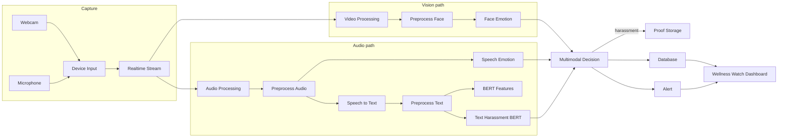

# Wellness Watch — Project Structure

Real-time multimodal (video + audio + text) harassment and emotion detection system.  
Product UI brand: **Wellness Watch**.

---

## 1. Repository layout

```
HarassmentDetectionSystem/
├── app.py / main.py              # Pipeline orchestrator (entry point)
├── requirements.txt              # Python dependencies
├── STRUCTURE.md                  # This document
│
├── modules/                      # Core detection pipeline (Modules 1–12)
│   ├── __init__.py
│   ├── device_input.py           # Module 1
│   ├── realtime_stream.py        # Module 2
│   ├── video_processing.py       # Module 3
│   ├── audio_processing.py       # Module 4
│   ├── preprocessing.py          # Module 5
│   ├── speech_to_text.py         # Module 6
│   ├── feature_extraction.py     # Module 7
│   ├── pretrained_models/        # Module 8
│   │   ├── __init__.py
│   │   ├── face_emotion.py
│   │   ├── speech_emotion.py
│   │   └── text_harassment.py
│   ├── multimodal_decision.py    # Module 9
│   ├── proof_storage.py          # Module 10
│   ├── database_module.py        # Module 11
│   ├── alert.py                  # Module 12
│   │
│   └── (compat shims — old import paths)
│       camera.py, audio_record.py, stream_module.py,
│       face_emotion.py, voice_emotion.py, text_classifier.py,
│       decision_engine.py, face_detection.py
│
├── database/
│   └── database_helper.py        # Re-exports Module 11 (dashboard compat)
│
├── dashboard/                    # Module 13 (Streamlit + Flask API)
│   ├── dashboard.py              # Streamlit UI
│   └── api.py                    # Flask REST API for React frontend
│
├── frontend/                     # Wellness Watch React dashboard (Vite)
│   ├── index.html
│   ├── package.json
│   ├── src/
│   │   ├── App.jsx               # Main UI
│   │   ├── App.css
│   │   ├── api.js                # Calls Flask API
│   │   ├── main.jsx
│   │   └── index.css
│   └── stitch/                   # Stitch design export (reference)
│
├── proof/
│   ├── images/                   # Face evidence (on harassment)
│   └── audio/                    # Audio evidence (on harassment)
│
├── Temp/audio/                   # Ephemeral live audio chunks
├── models/                       # Optional local model weights
├── data/                         # Optional test assets
└── test_*.py                     # Smoke / integration tests
```

---

## 2. Thirteen-module architecture

| # | Module | File | Purpose | Output |
|---|--------|------|---------|--------|
| 1 | Device Input | `modules/device_input.py` | USB webcam + mic capture (OpenCV, sounddevice) | Raw video / audio streams |
| 2 | Real-Time Stream | `modules/realtime_stream.py` | Threaded capture; ~15–20 FPS capture, 1 FPS process; 3–5 s audio chunks | Frame queue, audio chunk queue |
| 3 | Video Processing | `modules/video_processing.py` | Haar Cascade face detect + crop | Cropped face image |
| 4 | Audio Processing | `modules/audio_processing.py` | Waveform convert, noise reduce, normalize | Clean audio signal |
| 5 | Preprocessing | `modules/preprocessing.py` | Image resize/normalize; audio trim/normalize; text clean (**no stopword removal**) | Processed face / audio / text |
| 6 | Speech-to-Text | `modules/speech_to_text.py` | Audio → text (SpeechRecognition) | Text sentence |
| 7 | Feature Extraction | `modules/feature_extraction.py` | BERT embeddings, image features, MFCC | Feature vectors |
| 8 | Pre-trained Models | `modules/pretrained_models/` | Face emotion (FER/ViT), speech tone, text harassment (**BERT**) | Emotion / tone / text class |
| 9 | Multimodal Decision | `modules/multimodal_decision.py` | Fuse three modalities | `harassment` / `stress` / `normal behaviour` |
| 10 | Proof Storage | `modules/proof_storage.py` | Save evidence only on harassment | `proof/images/`, `proof/audio/` |
| 11 | Database | `modules/database_module.py` | Prediction history (MongoDB / SQLite / CSV) | History records |
| 12 | Alert | `modules/alert.py` | Real-time warning notification | Alert message + log |
| 13 | Dashboard | `dashboard/` + `frontend/` | Visualize live status, logs, evidence | Streamlit / Wellness Watch UI |

---

## 3. End-to-end pipeline order

Executed by `app.py` / `main.py`:

```
1.  Webcam captures live video                 → Module 1
2.  Stream extracts frames                     → Module 2
3.  Haar Cascade detects face                  → Module 3
4.  Face image preprocessed                    → Module 5
5.  Microphone records speech (parallel)       → Modules 1–2, 4
6.  Speech converted to text                   → Module 6
7.  BERT analyzes sentence meaning             → Modules 7–8 (text)
8.  CNN/ViT detects facial emotion             → Module 8 (face)
9.  Audio model detects voice tone             → Module 8 (speech)
10. Decision module combines all three         → Module 9
11. If harassment → store proof                → Module 10
12. Result saved to database                   → Module 11
13. Alert + dashboard display                  → Modules 12–13
```

### Decision rule (Module 9)

Harassment when **all** of:

- face emotion = `angry`
- text class = `harassment` or `abusive`
- speech tone = `angry tone` (aggressive)

Partial concerning signals → `stress`  
Otherwise → `normal behaviour`

---

## 4. Data flow (simplified)



---

## 5. Frontend — Wellness Watch

| Piece | Role |
|-------|------|
| `frontend/` | React + Vite professional UI |
| `dashboard/api.py` | Flask API (`/api/latest`, `/history`, `/stats`, proof files) |
| `dashboard/dashboard.py` | Optional Streamlit view of the same data |

UI sections:

1. Brand header — **Wellness Watch**
2. Live status banner (stable / stress / harassment)
3. Signal tiles — face, voice, language, overall result
4. Activity log table
5. Outcome mix chart + evidence panel

---

## 6. Database backends (Module 11)

Set environment variable `HDS_DB_BACKEND`:

| Value | Storage |
|-------|---------|
| `mongo` (default) | MongoDB `harassment_detection.history` |
| `sqlite` | `database/history.db` (or `HDS_SQLITE_PATH`) |
| `csv` | `database/history.csv` (or `HDS_CSV_PATH`) |

Record fields: `timestamp`, `face_emotion`, `speech_emotion`, `text_prediction`, `final_result`, optional `proof_image` / `proof_audio`.

---

## 7. How to run

```bash
# 1) Detection pipeline
python app.py

# 2) API for React UI
python dashboard/api.py

# 3) Wellness Watch frontend
cd frontend
npm install
npm run dev
# → http://localhost:5173/

# Optional Streamlit dashboard
streamlit run dashboard/dashboard.py

# Offline integration tests (uses SQLite)
python test_integration.py
```

Python deps: `pip install -r requirements.txt`

---

## 8. Tech stack

| Layer | Technologies |
|-------|----------------|
| Capture | OpenCV, sounddevice, threading |
| Vision | Haar Cascade, HuggingFace ViT (FER-style) |
| Audio | Librosa, NumPy, SciPy |
| NLP | SpeechRecognition, HuggingFace BERT (`unitary/toxic-bert`) |
| Fusion | Rule-based multimodal decision |
| Storage | File proof folders; MongoDB / SQLite / CSV |
| UI | React (Wellness Watch), Flask API, Streamlit |

---

## 9. Known gaps / stubs

| Area | Status |
|------|--------|
| Speech emotion | Acoustic heuristics (not a full RAVDESS LSTM/CNN checkpoint) |
| Image CNN features | Lightweight spatial features (not a trained backbone penultimate layer) |
| STT | Google SpeechRecognition (Whisper/wav2vec swappable later) |
| MediaPipe | Not used; Haar Cascade is the face detector |

---

## 10. Naming note

Repo folder remains `HarassmentDetectionSystem` (technical project name).  
User-facing product name in the React UI is **Wellness Watch**.
